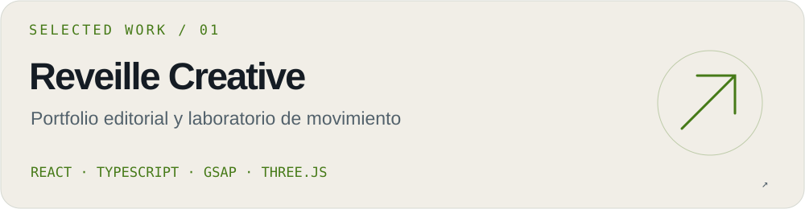
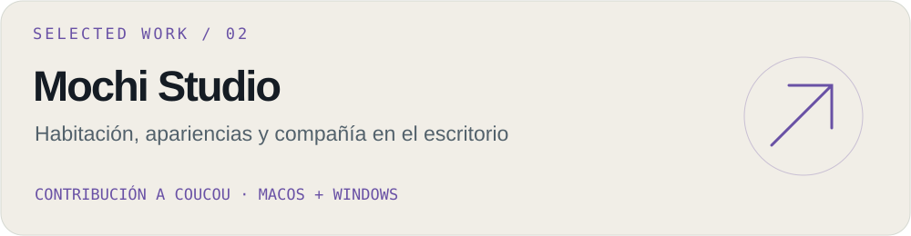

<picture>
  <source media="(prefers-color-scheme: dark)" srcset="assets/hero-dark.svg">
  
</picture>

Me gusta construir interfaces visuales, cuidar el movimiento y convertir ideas en cosas que se puedan probar. Aquí reúno mis proyectos y las contribuciones que estoy preparando.

### Proyectos seleccionados

<a href="https://github.com/CHAPAS939/Pruebas">
  <picture>
    <source media="(prefers-color-scheme: dark)" srcset="assets/reveille-dark.svg">
    
  </picture>
</a>

**Reveille Creative** — Portfolio conceptual con escenas WebGL, animación y una biblioteca de interacciones. [Explorar el proyecto ↗](https://github.com/CHAPAS939/Pruebas)

<a href="https://github.com/CHAPAS939/Pruebas/tree/build/coucou-mochi-installers">
  <picture>
    <source media="(prefers-color-scheme: dark)" srcset="assets/mochi-dark.svg">
    
  </picture>
</a>

**Mochi Studio** — Una contribución a [Coucou, de Louis Raillé](https://github.com/louis-cfm/coucou): habitación editable, apariencias y enganche automático a ventanas. [Código y comprobaciones ↗](https://github.com/CHAPAS939/Pruebas/tree/build/coucou-mochi-installers)

### En lo que estoy trabajando

Personalización de Mochi, detalles de interacción y una presentación clara de la contribución para revisión.

**Tecnologías de estos proyectos:** React · TypeScript · GSAP · Three.js · Swift · Rust · Tauri.

---

Código, movimiento y pequeños detalles. Coucou y Mochi pertenecen a Louis Raillé; la contribución se identifica como beta de la comunidad.
