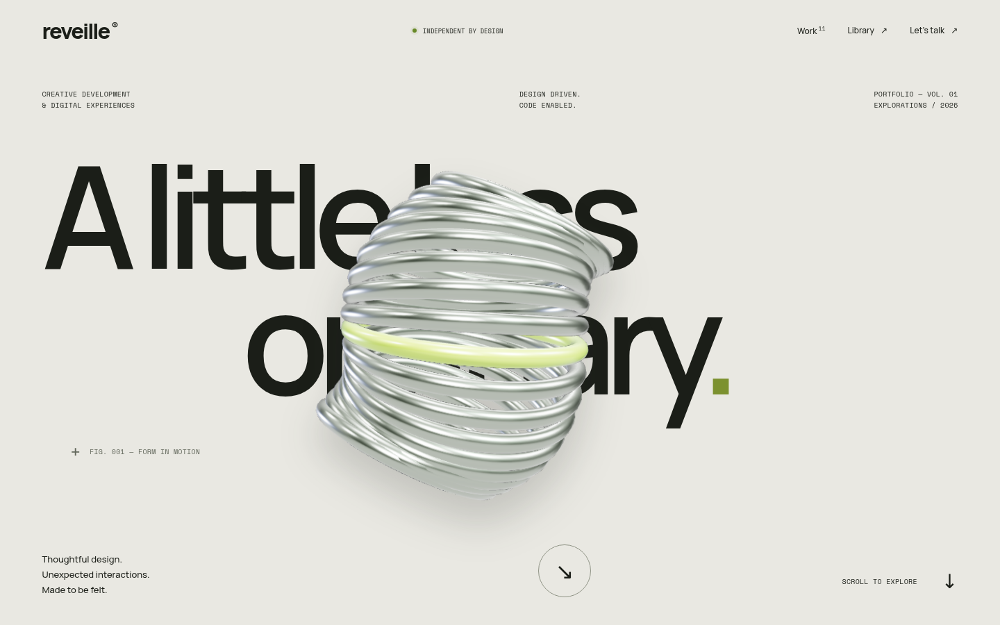

# Reveille Creative

An original editorial portfolio and real-time motion playground, built from scratch in React 19, TypeScript, Vite, TanStack Router, GSAP and Three.js.



## Run locally

Requires Node.js 22.12+ (or Node 24) and npm.

```sh
npm ci
npm run dev
```

Open http://localhost:5173. Production build and local preview:

```sh
npm run build
npm run preview
```

There is no backend, API key, account setup, external asset service or database. Fonts and original procedural visuals are bundled with the application. Optional contact details: copy `.env.example` to `.env.local` and set `VITE_CONTACT_EMAIL`; otherwise the contact section links to this repository.

## Experience

- Monumental animated hero with a reflective, original 3D sculpture.
- Word-by-word editorial About reveal and eleven asymmetric project studies.
- Pinned, reversible Design & Code timeline with opposing type and a 3D ampersand transform.
- Exactly thirteen expandable motion feeds: five WebGL scenes and eight CSS/DOM compositions.
- Nine keyboard-accessible FAQ entries and a scroll-linked closing sequence.
- Searchable, filterable library with six interactive demos and copyable snippets.
- Responsive navigation, native accessible dialogs, reduced-motion support and explicit WebGL fallback.

All projects are original concept studies. The camera labels are thematic: no videos, audio recordings, external AI integrations, or actual screen recordings are represented as having been produced.

## Routes

- `/`
- `/library`
- `/prompts/menu-icon-morph`
- `/prompts/animated-footer-ascii`
- `/prompts/ai-status-orb`
- `/prompts/magnetic-button`
- `/prompts/kinetic-type`
- `/prompts/orbital-study`
- `/legal`
- `/privacy`

## Source map

| File | Responsibility |
| --- | --- |
| `src/main.tsx` | TanStack route tree, lazy internal pages, font imports |
| `src/components/portfolio/HomeSections.tsx` | Homepage, eleven studies, camera and project dialogs |
| `src/components/portfolio/use-motion.ts` | Scoped GSAP choreography and responsive ScrollTriggers |
| `src/components/portfolio/ArtCanvas.tsx` | Original geometry, shaders, lighting and WebGL resource lifecycle |
| `src/components/portfolio/MotionArt.tsx` | Thirteen camera compositions and visibility-aware CSS playback |
| `src/components/portfolio/SiteShell.tsx` | Navigation, mobile dialog, footer links |
| `src/components/portfolio/PromptDemo.tsx` | Library demos and interactive controls |
| `src/lib/site-config.ts` | Project inventory, nine FAQ entries, contact configuration |
| `src/lib/prompts.ts` | Library metadata and original code snippets |
| `src/routes/library.tsx` | Search and category filtering |
| `src/routes/prompts.$slug.tsx` | Demo detail and clipboard controls |
| `src/styles.css` | Editorial design system, art direction, CSS loops and responsive layouts |
| `tests/experience.spec.ts` | Real browser checks and screenshot evidence |

## Validation

```sh
npm run lint
npm run build
npm test
```

Tests use `/usr/bin/chromium` by default. On another machine:

```sh
npx playwright install chromium
CHROMIUM_PATH="$(node -e "console.log(require('@playwright/test').chromium.executablePath())")" npm test
```

The suite checks seven viewports (1920×1080, 1440×900, 1366×768, 1024×768, 768×1024, 390×844, 375×812), six scroll positions each, motion transforms and reversal, all thirteen cameras at two times, library filters and clipboard, project dialogs, FAQ, mobile navigation, keyboard focus and reduced motion. The GitHub Actions workflow repeats lint, build and browser checks and uploads evidence.

See [motion audit](motion-audit.md), [reference audit](reference-audit.md), [browser results](docs/evidence/test-results.json) and [screenshots](docs/evidence).

## Hosting

`npm run build` generates `dist/`. Deploy to a static host with an SPA fallback to `index.html` for unknown paths. `public/_redirects` supplies the common Netlify/Cloudflare Pages fallback. On nginx use `try_files $uri $uri/ /index.html;`. GitHub Pages requires additional subpath/base configuration and a fallback strategy; this repository does not automatically publish a public site.

## Reference limitations

The requested reference, louisraille.fr, could not be loaded through either web retrieval or real Chromium (`ERR_TUNNEL_CONNECTION_FAILED`). This implementation follows the supplied section and interaction inventory with original art direction. It is **not a visually verified replica**. There are no claimed similarity scores. No third-party artwork or identity was copied.

The previous application's source, exact FAQ wording and unknown internal routes were not available. Questions, copy and additional library demos were therefore authored anew. WebGL motion is tested in software-rendered Chromium; physical device GPU performance remains unmeasured.

## License

Original code and procedural artwork: [MIT](LICENSE). Font and dependency licenses remain with their respective packages. Manrope, Space Mono and Noto Sans Symbols 2 use the SIL Open Font License. A small DejaVu-derived symbol subset is bundled with its Bitstream Vera license in `public/fonts/LICENSE-DejaVu.txt`.
