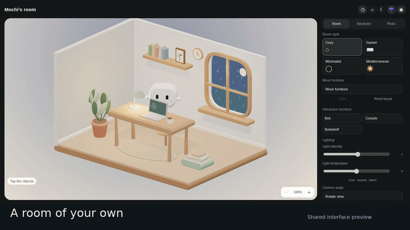
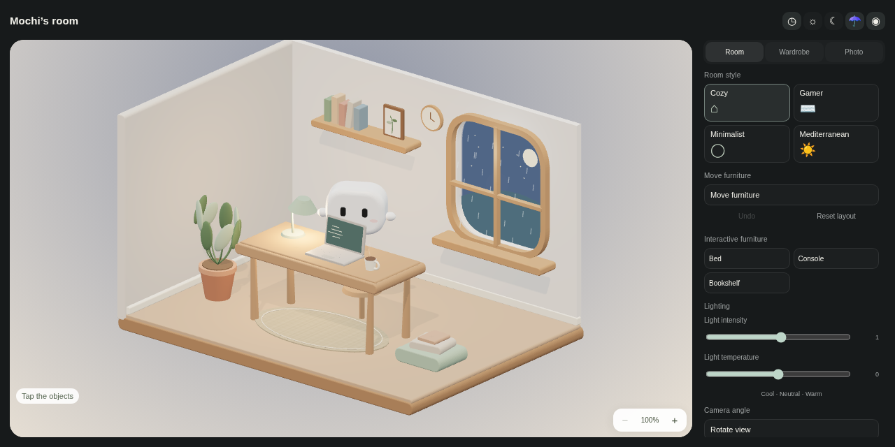
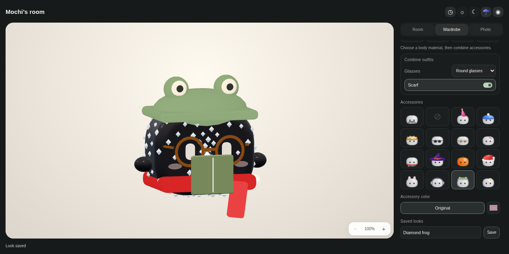

# Mochi Studio — source and design review

An editable room, saved looks and native window companionship for Coucou, based on upstream revision `b1bc09de7f7c24a80bd8eca5729b8bee60f66402`.

## Start here

- [Room and wardrobe draft](https://github.com/Jose-SMG/Pruebas/pull/1): source changes relative to the upstream snapshot.
- [Window attachment and jumps draft](https://github.com/Jose-SMG/Pruebas/pull/2): stacked on the room contribution.
- [Integrated source branch](https://github.com/Jose-SMG/Pruebas/tree/build/coucou-mochi-installers).
- [Overlap with wardrobe PRs #1025, #737 and #738](WARDROBE-OVERLAP.md).

These are draft reviews in the contributor's repository, not pull requests opened against Louis's repository. No merge or endorsement is implied. The feature branches exclude beta packaging and publication metadata.

## Room and outfits

The GIF and recording show the actual shared editor running with its development bridge. They are interface demonstrations, rather than evidence of native window tracking.







[Watch the 68-second room and outfits recording](room-and-outfits.mp4).

The room has Cozy, Gamer, Minimalist and Mediterranean styles, movable furniture, camera and lighting controls, and saved layouts. The wardrobe combines a body appearance, outfit, glasses and scarf. Diamond Mochi keeps a rounded black body with many small bright stones.

## Native attachment and jumps

The second draft contains the AppKit/Win32 implementation: automatic edge selection on release, arm grip, target following and arc jumps. Keyboard modifiers are not required for attachment. Full installed-app interaction QA and a verified native jump recording remain pending, so this contribution stays a draft. Native selection tests and a successful build do not by themselves verify the complete drag-and-jump experience.

## Build from source

```sh
git clone --branch contrib/mochi-room-review-0.6 https://github.com/Jose-SMG/Pruebas.git coucou-review
cd coucou-review
```

For the stacked window contribution, check out `contrib/mochi-window-perch-review-0.6` instead.

On Mac, install Xcode and XcodeGen, then follow the project's normal development flow:

```sh
cd NotchBuddy
xcodegen generate
open NotchBuddy.xcodeproj
```

On Windows, install the upstream Rust/Tauri/WebView2 build prerequisites and Node, then:

```sh
cd windows
npm ci
npm run tauri -- dev
```

Both integrated native packages compiled from source revision `6b4e5ea2f80ab59375973c73034d1f16d020b49e`. The Mac build also rendered the packaged studio in WebKit and exported a valid PNG. [Build and test details](https://github.com/Jose-SMG/Pruebas/actions/runs/42304291267) include a failed interactive automation job; full interaction QA is not marked complete. Physical multi-monitor/DPI checks and Mac Accessibility behavior remain review items.

## Decisions for review

The room bundles an offline Three.js renderer shared by WebKit and WebView2. This adds a third-party dependency and additional Windows webviews, and needs review against Coucou's dependency and resource guidelines. It receives cosmetic settings, not agent prompts or credentials. The original Canvas renderer remains as fallback.

The open wardrobe PRs propose other outfit/skin paths. This draft has not been merged with them or tested for compatibility. The overlap note identifies shared code and proposes choosing one canonical wardrobe path before expanding this part.

Coucou, Mochi and the original artwork and sounds belong to Louis Raillé. Existing source and dependency notices are retained.
